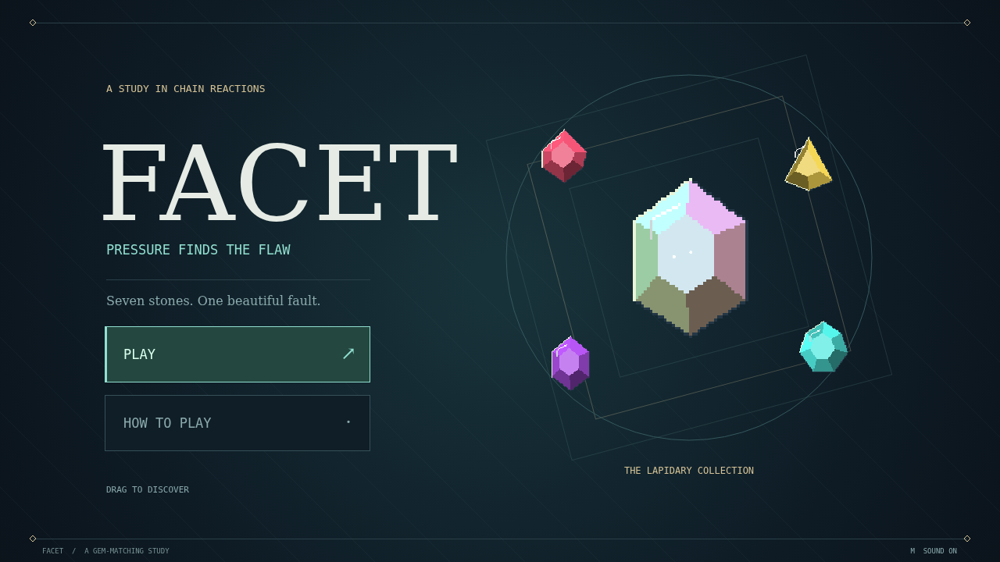

# Facet

Every stone has a breaking point. Facet is a gem-matching puzzle about finding it: take hold of a stone, offer it onto a neighbor, and release to turn three of a kind into a shower of glittering fragments.

The stones left behind remember. Each nearby clear adds strain, from a hairline crack to a dangerous, gleaming flaw. Touch a flawed stone with your next clear and it breaks too, paying double and carrying the reaction into the next pocket of the board.

Make four in a line to earn a brilliant that breaks its surrounding ring. Cross two lines to make a star that cuts through a whole row and column. Match five to reveal a kindless prism: trade it with any stone to sweep away every gem of that kind.

Watch the gaps fill, the chain climb, and a careful little swap become something extraordinary. Fill each level's target, take stock of your finest move, and begin again on a fresh field. The round ends only when the board has no productive move left.

